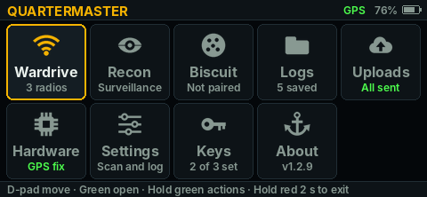
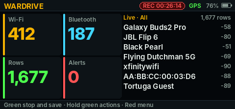
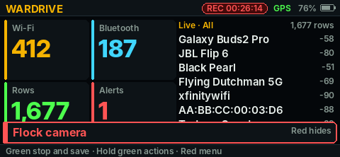
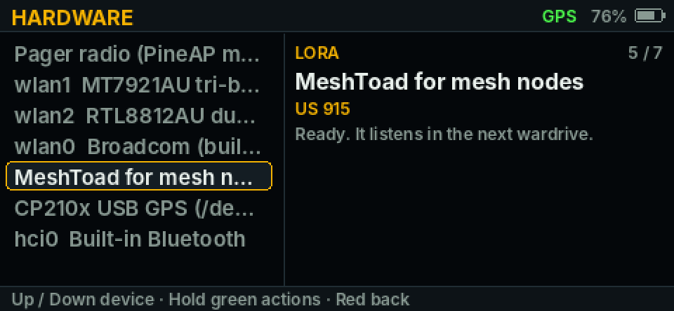
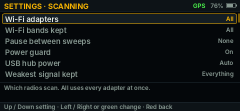
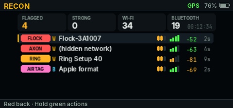
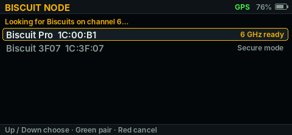
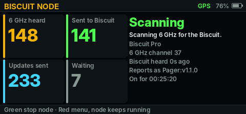

# Quartermaster-Pager

Quartermaster as a payload for the Hak5 WiFi Pineapple Pager. The payload itself, with its user guide, is in
[`payload/quartermaster`](payload/quartermaster). That folder is what goes into Hak5's payload library at
`library/user/reconnaissance/quartermaster/`.

This repo stands apart from [Quartermaster](https://github.com/valleytechsolutions/Quartermaster): nothing here
changes the CardputerZero or Raspberry Pi versions, their releases or their store packages.

## Layout

| Path | What it is |
| --- | --- |
| `payload/quartermaster/payload.sh` | The Pager payload: package check, screen handover, start and clean exit |
| `payload/quartermaster/qmpager/` | The Pager's parts: screen, buttons, buzzer, lights, Wi-Fi from `wlan1mon`, Bluetooth over HCI, USB LoRa, the wide screens |
| `payload/quartermaster/quartermaster/` | The Quartermaster core, copied unchanged from the release in `core.lock` (node firmware left out) |
| `tools/sync_core.py` | Copies the core from a Quartermaster release: `python3 tools/sync_core.py <tag or commit>` |
| `tools/render_screens.py` | Draws every Pager screen to `docs/screens` |
| `tests/` | `python3 -m pytest tests` |

## Screens

| | |
| --- | --- |
|  |  |
|  |  |
|  |  |
|  |  |

## License

GPL-3.0. See the payload's README for credits.
